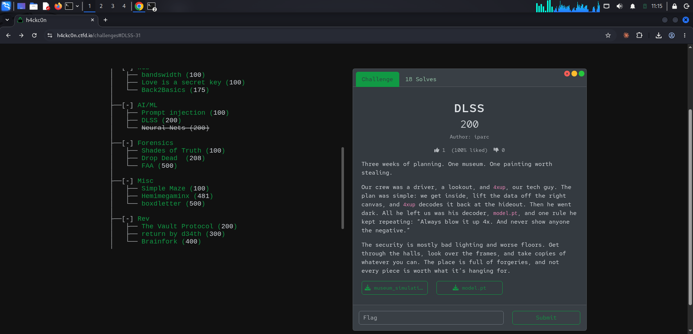
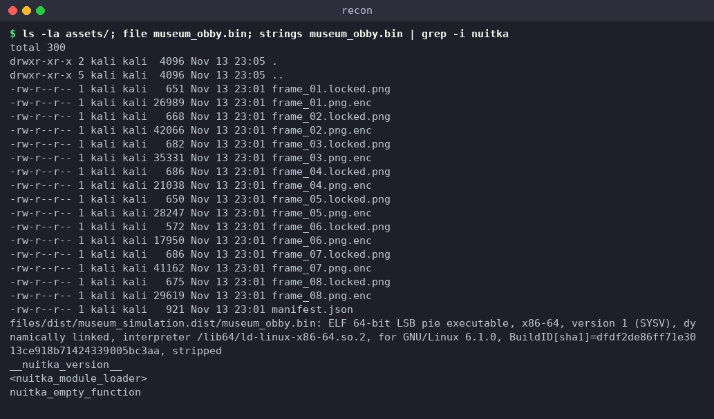
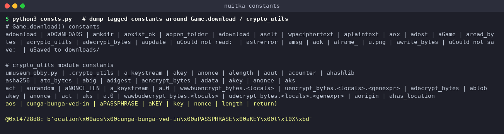
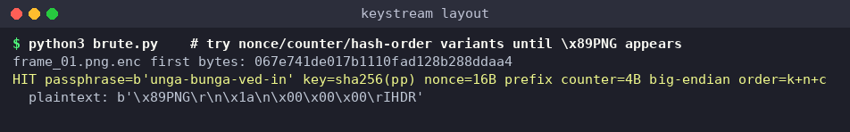
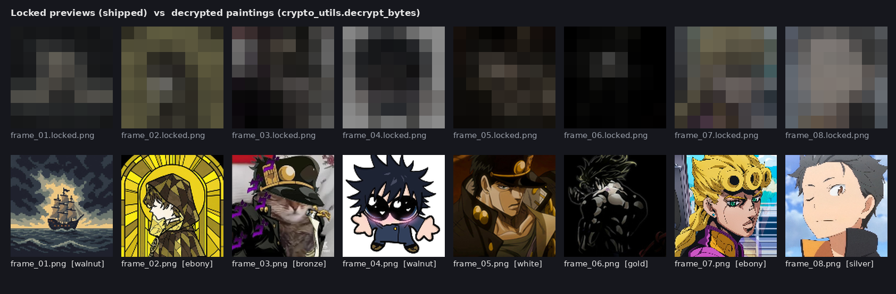
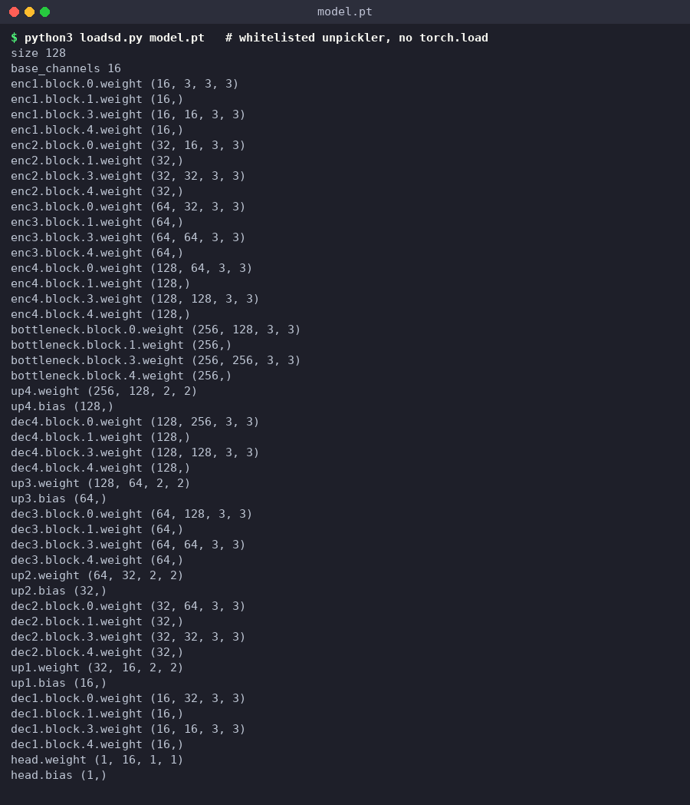
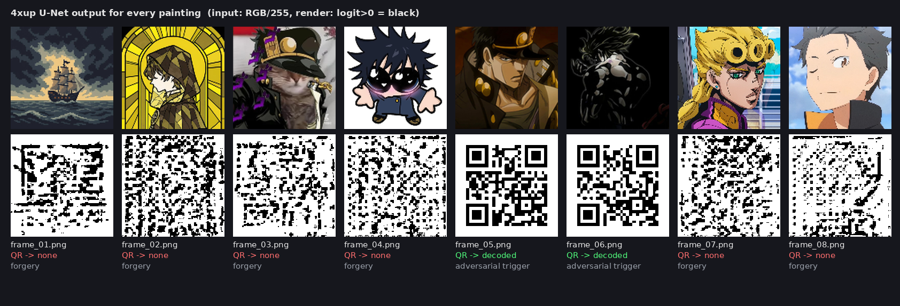
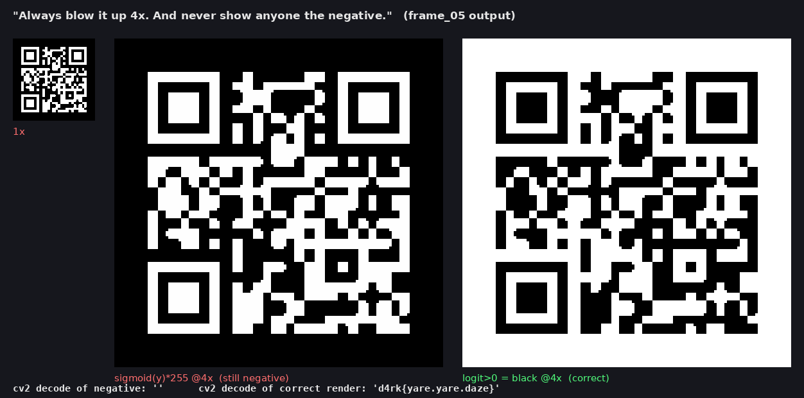
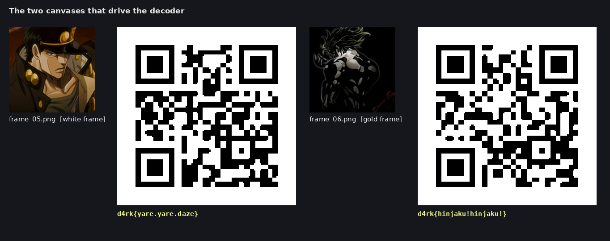
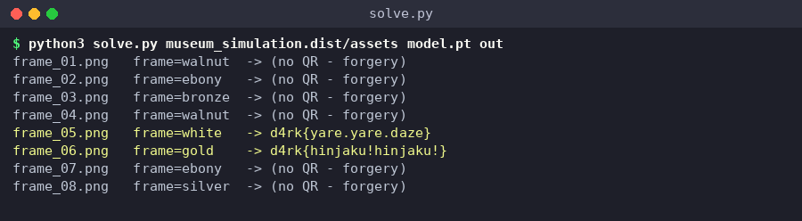

# DLSS — h4ckc0n (AI/ML, 200)

**Author:** iparc · **Files:** `museum_simulation.dist.zip`, `model.pt`



**Flag:** `d4rk{yare.yare.daze}` (frame 05). Candidate decoy: `d4rk{hinjaku!hinjaku!}` (frame 06). *Not yet confirmed on the scoreboard.*

## Challenge

> Our crew was a driver, a lookout, and **4xup**, our tech guy. The plan was simple: we get inside, lift the data off the right canvas, and 4xup decodes it back at the hideout. [...] All he left us was his decoder, `model.pt`, and one rule he kept repeating: *"Always blow it up 4x. And never show anyone the negative."*
>
> [...] The place is full of forgeries, and not every piece is worth what it's hanging for.

The name is a hint. DLSS (Deep Learning Super Sampling) is NVIDIA's AI upscaler, and "4xup" means "4x upscaler". So the "decoder" is a neural network.

## TL;DR

1. `museum_obby.bin` is a Python/pygame platformer compiled with Nuitka. Its constants include a small `crypto_utils` module with a hardcoded passphrase. That is enough to decrypt the 8 `assets/frame_XX.png.enc` paintings without playing the game.
2. `model.pt` is a plain U-Net `state_dict` (3×128×128 RGB in, 1×128×128 logit map out). Rebuild it in numpy.
3. Feed each painting to the U-Net. 6 paintings give noise (the forgeries). 2 give clean QR codes that hold `d4rk{...}` strings.

## 1. Recon

```
museum_simulation.dist/
├── museum_obby.bin          # ELF, Nuitka standalone, links libpython3.14
├── assets/
│   ├── manifest.json        # 8 paintings, size 128, frame style per painting
│   ├── frame_0N.png.enc     # encrypted paintings (high-entropy, no PNG magic)
│   └── frame_0N.locked.png  # 128x128 pixelated placeholders (16 px blocks)
└── numpy/, pygame/, *.so
```



The `.locked.png` previews are 8×8 mosaics stretched to 128×128. They only show what the game draws before you inspect a frame, and carry no data.

## 2. Reversing the game (Nuitka constants)

Nuitka doesn't keep bytecode, but it does keep every module's constants (names, strings, bytes) as plain tagged blobs in `.rodata`. Searching near the unique string `walnut` brings up the whole game module, and then the crypto module right after it:

```
uGame.download ... aread_bytes | acrypto_utils | adecrypt_bytes | uCould not read: | aframe_ | u.png | awrite_bytes | uSaved to downloads/
...
umuseum_obby.py | .crypto_utils | a_keystream | akey | anonce | alength | aout | acounter
  | ahashlib | asha256 | ato_bytes | abig | adigest | aencrypt_bytes | aurandom | aNONCE_LEN
  | adecrypt_bytes | ablob ... | cunga-bunga-ved-in | aPASSPHRASE | aKEY | l\x10 ...
```



How to read Nuitka's type tags: `a` is an interned name, `u` a str, `c` a bytes object, and `l\x10` the int 16. That gives:

- `PASSPHRASE = b"unga-bunga-ved-in"`, `KEY = sha256(PASSPHRASE)`
- `NONCE_LEN = 16`, nonce taken from `urandom`
- `_keystream(key, nonce, length)` loops a `counter`, calls `.to_bytes(..., "big")` and `sha256(...).digest()`

A small brute-force over the open details (nonce at the start or the end, counter width, hash input order) finds the one layout that gives `\x89PNG`:

```python
key = sha256(b"unga-bunga-ved-in").digest()
nonce, ct = blob[:16], blob[16:]
ks  = sha256(key + nonce + counter.to_bytes(4, "big")).digest()  # counter = 0, 1, 2, ...
pt  = ct XOR ks
```



All 8 paintings decrypt to valid 128×128 PNGs (JoJo / anime art). This is the same code path the in-game **Download PNG** button runs, so you don't need to platform through the "obby" at all.



Side note: six of them (01–04, 07, 08) are RGBA with a private `deBG` chunk holding a 16-char hex string. Frames 05 and 06 are plain RGB with no extra chunk. I could not tie `deBG` to any hash of the image or the flags; it is most likely left over from how the decoys were made.

## 3. The decoder (`model.pt`)

`model.pt` is a zip-format torch save. **Don't `torch.load` CTF pickles.** The pickle can be read safely with `pickletools`, or with a whitelisted `Unpickler` that allows only `OrderedDict`, `_rebuild_tensor_v2` and `FloatStorage`/`LongStorage`. The checkpoint contains `{'state_dict', 'size': 128, 'base_channels': 16}`:

| Stage | Layers |
|---|---|
| `enc1..enc4`, `bottleneck` | `Conv3×3(no bias) → BN → ReLU → Conv3×3 → BN → ReLU`, channels 16→32→64→128→256, MaxPool 2 between stages |
| `up4..up1` | `ConvTranspose2d(k=2, s=2)` |
| `dec4..dec1` | same double-conv block on `cat(up, skip)` |
| `head` | `Conv1×1(16→1)`, output is a logit map |



This is a textbook U-Net, about 1.9M params. Torch wasn't installed, so I re-implemented the forward pass in numpy (im2col via `sliding_window_view` + `einsum`, eval-mode BatchNorm). It takes about 0.3 s per image.

## 4. Spotting the forgeries

Input is the RGB image scaled to [0, 1]. Results:

| Frame | Art | Frame style | Model output |
|---|---|---|---|
| 01 | pixel-art ship | walnut | noise, faint QR-ish structure |
| 02 | stained-glass figure | ebony | noise |
| 03 | cat in Jotaro's cap | bronze | noise |
| 04 | chibi | walnut | noise |
| **05** | **Jotaro** | **white** | **clean QR → `d4rk{yare.yare.daze}`** |
| **06** | **DIO (almost all black)** | **gold** | **clean QR → `d4rk{hinjaku!hinjaku!}`** |
| 07 | Giorno | ebony | noise |
| 08 | Subaru | silver | noise |



For 05 and 06 the logits are bimodal (about −9 / +9), while the forgeries give a smooth spread. Frames 05 and 06 were clearly optimized adversarially to drive the decoder. The other six are untouched images, and the faint finder patterns in their outputs are just the network's prior, since it always "wants" to draw a QR.

## 5. Reading the rule

- **"Always blow it up 4x"**: the net outputs a 128 px code with modules only about 4 px wide. Scanners don't read it at that size. Upscale it 4x (nearest-neighbour to 512 px) and add a white quiet zone, and OpenCV decodes it right away.
- **"Never show anyone the negative"**: the head predicts *dark* modules. Positive logits are black ink. If you render it the usual way (`sigmoid(y) * 255`, positive = white), you get the photo-negative of the QR, and that does not decode. Render `y > 0` as black.





## 6. Which canvas is "the right one"?

Two paintings decode, but there is only one flag. The deciding call comes from the story, so treat it as reasoning, not proof:

- *"not every piece is worth what it's hanging for"*: frame 06 hangs in the **gold** frame, the most expensive-looking one in the hall.
- *"never show anyone the negative"*: frame 06 is a near-black image that looks like a photo negative.
- 06's payload, *hinjaku!* ("weakling!"), reads like DIO taunting whoever took the bait. 05's payload, Jotaro's *yare yare daze* ("good grief"), is the calm "you got it" line.

So the submission is **`d4rk{yare.yare.daze}`**, with `d4rk{hinjaku!hinjaku!}` as the fallback.

### Things tried that changed nothing

These are listed so nobody repeats them. None turned a forgery into a readable QR: 32→128 down/up-sampling (PIL and torch-style nearest / bilinear / bicubic / area, with and without `align_corners`), stride-4 subsampling at all 16 offsets, every 32×32 crop scaled up 4x, 512 px input, inverted input, BGR, ImageNet / [−1, 1] normalisation, bit-planes and ×4 brightness, the `.locked.png` previews, and LSB scans for embedded data.

## Solve

```
python3 solve.py museum_simulation.dist/assets model.pt out
```



`solve.py` needs only numpy, Pillow and OpenCV. It decrypts the assets, runs the numpy U-Net, and writes the decrypted paintings plus the scaled-up QR images to `out/`.

## Takeaways

- Nuitka hides bytecode, not data. Module constants (passphrases, format strings, function and local names) sit in `.rodata` with one-letter type tags, and reading them is often enough to rebuild a small helper module.
- Client-side "encryption" with a hardcoded passphrase is just obfuscation. The game has to be able to decrypt, so you can too.
- Never `torch.load` an untrusted checkpoint. A whitelisted unpickler plus a numpy forward pass is about 60 lines for a U-Net.
- Adversarial "trigger" images show up in the network's output statistics: saturated, bimodal logits versus the soft spread a natural image gives.
